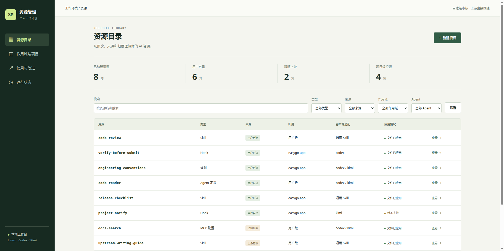

# SM

Linux 本地 AI 资源管理：可视化维护、跨机器恢复、夜间同步与基于使用记录的改进提案。

- 管理 Skill、Hook、规则、Agent 定义和 MCP 配置，区分来源与用户／项目作用域。
- Skill 只有一份通用内容，Codex、Kimi 通过共享目录加载。
- 自建修改经 MR 审核合并后再同步生效；上游定时直接跟随，不参与本地优化。
- 日常轻量记录，夜间提出带证据和验证边界的 Draft MR，人工决定是否合并。

```sh
git clone http://git.standard-robots.com/yicao/sm
cd sm
./sm init
```

前端：<http://127.0.0.1:8765>。需要 Python 3.10+、Git、systemd 用户会话，复用本机 Codex／Kimi 和 GitLab 认证。

[使用说明](docs/usage.md) · [验证结果与限制](docs/verification.md) · [需求](docs/superpowers/specs/2026-10-21-sm-design.md) · [实施计划](docs/superpowers/plans/2026-10-21-sm-phase-one.md)


