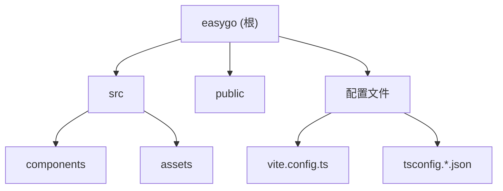

# easygo - Vue 3 + TypeScript + Vite 前端项目

## 变更记录 (Changelog)

| 日期       | 变更内容                               | 版本   |
| ---------- | -------------------------------------- | ------ |
| 2026-02-24 | 初始化 AI 上下文文档，建立项目架构基线 | v0.1.0 |

---

## 项目愿景

easygo 是一个基于 Vue 3 + TypeScript + Vite 的现代化前端项目模板。项目采用 Vue 3 组合式 API（Composition API）和 `<script setup>` 语法糖，配合 TypeScript 严格类型检查，提供高效的开发体验和可靠的代码质量保障。

**核心特性：**

- Vue 3 最新特性：组合式 API、响应式系统、单文件组件
- TypeScript 严格模式：完整类型安全、编译时检查
- Vite 8.0 Beta：极速冷启动、HMR（热模块替换）
- 现代构建工具链：pnpm 包管理、ESBuild 转译

---

## 架构总览

### 技术栈

| 分层     | 技术选型   | 版本          | 用途                |
| -------- | ---------- | ------------- | ------------------- |
| 框架     | Vue        | 3.5.25        | 视图层框架          |
| 语言     | TypeScript | 5.9.3         | 类型系统            |
| 构建工具 | Vite       | 8.0.0-beta.13 | 开发服务器与构建    |
| 包管理器 | pnpm       | -             | 依赖管理            |
| 编译器   | vue-tsc    | 3.1.5         | TypeScript 类型检查 |

### 项目结构

```
easygo/
├── public/             # 静态资源（不经过构建）
│   └── vite.svg       # Vite 图标
├── src/               # 源代码目录
│   ├── assets/        # 需要构建的资源
│   │   └── vue.svg    # Vue 图标
│   ├── components/    # Vue 组件
│   │   └── HelloWorld.vue
│   ├── App.vue        # 根组件
│   ├── main.ts        # 应用入口
│   └── style.css      # 全局样式
├── index.html         # HTML 入口
├── vite.config.ts     # Vite 配置
├── tsconfig.json      # TypeScript 根配置
├── tsconfig.app.json  # 应用代码 TS 配置
├── tsconfig.node.json # Node 环境 TS 配置
└── package.json       # 项目元信息
```

---

## 模块结构图



---

## 模块索引

| 模块路径          | 类型     | 职责描述                         | 入口文件         | 状态    |
| ----------------- | -------- | -------------------------------- | ---------------- | ------- |
| `src/`            | 应用层   | 应用源代码、组件、样式与资源管理 | `main.ts`        | ✅ 活跃 |
| `src/components/` | 组件层   | 可复用 Vue 组件库                | `HelloWorld.vue` | ✅ 活跃 |
| `src/assets/`     | 资源层   | 需要构建处理的静态资源           | -                | ✅ 活跃 |
| `public/`         | 静态资源 | 不经过构建的公共资源             | -                | ✅ 活跃 |

---

## 运行与开发

### 环境要求

- Node.js: >= 18.0.0
- pnpm: 最新版本（推荐）

### 快速启动

```bash
# 安装依赖
pnpm install

# 启动开发服务器（默认 http://localhost:5173）
pnpm dev

# 构建生产版本
pnpm build

# 预览生产构建
pnpm preview
```

### 开发工作流

1. **本地开发**：运行 `pnpm dev` 启动 Vite 开发服务器，支持 HMR
2. **类型检查**：`pnpm build` 会先执行 `vue-tsc -b` 进行类型检查
3. **代码编辑**：推荐使用 VSCode + Volar 插件（见 `.vscode/extensions.json`）

---

## 测试策略

### 当前状态

- ⚠️ **尚未配置测试框架**
- 推荐引入：Vitest + @vue/test-utils

### 建议测试策略

| 测试类型 | 工具推荐           | 覆盖目标           |
| -------- | ------------------ | ------------------ |
| 单元测试 | Vitest             | 组件逻辑、工具函数 |
| 组件测试 | @vue/test-utils    | 组件渲染、交互     |
| E2E 测试 | Playwright/Cypress | 用户流程           |

---

## 编码规范

### TypeScript 配置

**严格模式已启用**（`tsconfig.app.json`）：

- `strict: true` - 启用所有严格类型检查
- `noUnusedLocals: true` - 禁止未使用的局部变量
- `noUnusedParameters: true` - 禁止未使用的参数
- `noFallthroughCasesInSwitch: true` - Switch 语句必须有 break
- `noUncheckedSideEffectImports: true` - 检查副作用导入

### Vue 组件规范

- 使用 `<script setup lang="ts">` 语法
- Props 使用 TypeScript 接口定义类型：`defineProps<{ msg: string }>()`
- 响应式数据使用 `ref()` 或 `reactive()`
- 组件文件名采用 PascalCase（如 `HelloWorld.vue`）

### 文件组织

- **组件目录**：`src/components/` - 所有可复用组件
- **资源目录**：`src/assets/` - 图片、字体等需构建资源
- **样式**：支持组件内 `<style scoped>` 和全局 `style.css`

---

## AI 使用指引

### 对话上下文建议

当与 AI 协作时，请明确以下信息：

1. **目标模块**：在 `src/components/` 还是根级组件？
2. **功能需求**：UI 展示、状态管理、路由导航等
3. **类型安全**：是否需要严格的 TypeScript 类型定义
4. **样式方案**：使用 scoped CSS 还是全局样式

### 常见任务模板

#### 创建新组件

```typescript
// src/components/NewComponent.vue
<script setup lang="ts">
interface Props {
  title: string
  count?: number
}

defineProps<Props>()
</script>

<template>
  <div>{{ title }}</div>
</template>

<style scoped>
/* 组件样式 */
</style>
```

#### 添加依赖

```bash
# 运行时依赖
pnpm add <package-name>

# 开发依赖
pnpm add -D <package-name>
```

### 代码修改建议

- 修改组件时，注意保持 TypeScript 类型定义的准确性
- 新增功能前，先检查是否需要安装额外依赖
- 修改配置文件（vite.config.ts、tsconfig.json）时，确保与现有配置兼容

---

## 配置层

### Vite 配置 (`vite.config.ts`)

```typescript
import { defineConfig } from "vite";
import vue from "@vitejs/plugin-vue";

export default defineConfig({
  plugins: [vue()],
});
```

**说明**：

- 使用官方 `@vitejs/plugin-vue` 插件处理 `.vue` 文件
- 默认配置，可根据需要扩展路径别名、代理、优化等

### TypeScript 配置

**三层配置结构**：

1. `tsconfig.json` - 根配置，引用子配置
2. `tsconfig.app.json` - 应用代码配置（src/\*\*）
3. `tsconfig.node.json` - Node 环境配置（vite.config.ts）

**关键配置**：

- `compilerOptions.types: ["vite/client"]` - 引入 Vite 客户端类型
- `include: ["src/**/*.ts", "src/**/*.vue"]` - 包含所有源代码

---

## src/ 源代码模块

[查看详细模块文档](./src/CLAUDE.md)

**快速概览**：

- **入口**：`main.ts` - 创建 Vue 应用实例并挂载
- **根组件**：`App.vue` - 应用根组件
- **组件库**：`components/HelloWorld.vue` - 示例计数器组件
- **全局样式**：`style.css` - 基础样式定义

---

## 依赖管理

### 运行时依赖

- `vue@3.5.25` - Vue 核心框架

### 开发依赖

- `@vitejs/plugin-vue@6.0.2` - Vite 的 Vue 插件
- `@vue/tsconfig@0.8.1` - Vue 官方 TypeScript 配置
- `typescript@5.9.3` - TypeScript 编译器
- `vite@8.0.0-beta.13` - 构建工具
- `vue-tsc@3.1.5` - Vue 组件类型检查

### pnpm 覆盖配置

```json
{
  "pnpm": {
    "overrides": {
      "vite": "^8.0.0-beta.13"
    }
  }
}
```

**说明**：强制所有依赖使用 Vite 8.0 beta 版本

---

## 下一步计划

### 建议补充功能

1. **路由管理**：引入 Vue Router

   ```bash
   pnpm add vue-router@4
   ```

2. **状态管理**：引入 Pinia

   ```bash
   pnpm add pinia
   ```

3. **测试框架**：配置 Vitest

   ```bash
   pnpm add -D vitest @vue/test-utils
   ```

4. **代码规范**：添加 ESLint + Prettier

   ```bash
   pnpm add -D eslint @vue/eslint-config-typescript prettier
   ```

5. **UI 组件库**：按需引入（Element Plus、Ant Design Vue 等）

---

## 常见问题 (FAQ)

### Q1: 如何修改开发服务器端口？

在 `vite.config.ts` 中配置：

```typescript
export default defineConfig({
  server: { port: 3000 },
});
```

### Q2: 如何配置路径别名？

```typescript
import path from "path";

export default defineConfig({
  resolve: {
    alias: {
      "@": path.resolve(__dirname, "src"),
    },
  },
});
```

### Q3: Vite 8.0 Beta 稳定吗？

当前使用 Beta 版本，建议关注官方更新，生产环境可考虑降级到稳定版 5.x。

### Q4: 如何处理环境变量？

创建 `.env` 文件，使用 `VITE_` 前缀：

```
VITE_API_URL=https://api.example.com
```

代码中通过 `import.meta.env.VITE_API_URL` 访问。

---

## 相关资源

- [Vue 3 官方文档](https://vuejs.org/)
- [Vite 官方文档](https://vite.dev/)
- [TypeScript 官方文档](https://www.typescriptlang.org/)
- [pnpm 官方文档](https://pnpm.io/)

---

**文档版本**: v0.1.0
**最后更新**: 2026-02-24
**维护者**: AI Assistant
