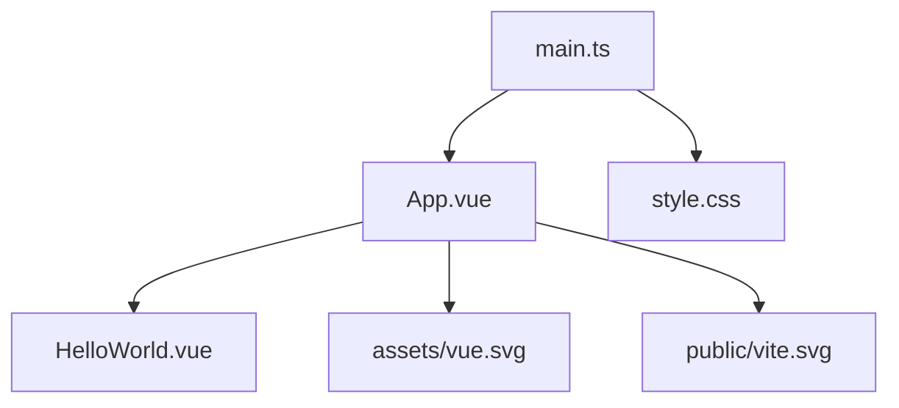

# src/ 模块文档

[根目录](../CLAUDE.md) > **src**

---

## 变更记录 (Changelog)

| 日期       | 变更内容            | 版本   |
| ---------- | ------------------- | ------ |
| 2026-02-24 | 初始化 src 模块文档 | v0.1.0 |

---

## 模块职责

`src/` 目录是项目的核心应用代码层，负责：

- Vue 应用的创建与初始化
- 根组件与可复用组件的定义
- 全局样式与资源管理
- 应用的完整视图层逻辑

---

## 入口与启动

### 应用入口：`main.ts`

```typescript
import { createApp } from "vue";
import "./style.css";
import App from "./App.vue";

createApp(App).mount("#app");
```

**启动流程**：

1. 从 `vue` 导入 `createApp` 工厂函数
2. 导入全局样式 `style.css`
3. 导入根组件 `App.vue`
4. 创建 Vue 应用实例并挂载到 `#app` DOM 节点（位于 `index.html`）

**关键特性**：

- 使用 Vue 3 的 `createApp` API（非 Vue 2 的 `new Vue()`）
- 支持热模块替换（HMR），修改代码后自动刷新

---

## 对外接口

### 根组件：`App.vue`

**组件结构**：

```vue
<script setup lang="ts">
import HelloWorld from "./components/HelloWorld.vue";
</script>

<template>
  <div>
    <a href="https://vite.dev" target="_blank">
      
    </a>
    <a href="https://vuejs.org/" target="_blank">
      
    </a>
  </div>
  <HelloWorld msg="Vite + Vue" />
</template>

<style scoped>
/* Logo 样式与悬停效果 */
</style>
```

**职责**：

- 应用的根布局容器
- 引入并渲染子组件（`HelloWorld`）
- 展示 Vite 和 Vue 的品牌图标
- 定义 scoped 样式（仅作用于当前组件）

**对外属性**：无（根组件不接收 props）

---

## 关键依赖与配置

### 依赖关系图



### 运行时依赖

| 依赖包 | 用途                            | 导入位置                    |
| ------ | ------------------------------- | --------------------------- |
| `vue`  | Vue 核心库（createApp、ref 等） | `main.ts`、所有 `.vue` 文件 |

### 类型定义

所有 `.vue` 文件的类型支持由 `vite/client` 提供（在 `tsconfig.app.json` 中配置）：

```json
{
  "compilerOptions": {
    "types": ["vite/client"]
  }
}
```

---

## 数据模型

### 组件状态管理

#### `HelloWorld.vue` 状态

```typescript
// 响应式计数器
const count = ref(0);
```

**说明**：

- 使用 Vue 3 `ref()` 创建响应式数据
- 类型自动推导为 `Ref<number>`
- 在模板中自动解包，直接使用 `count`（不需要 `.value`）

#### Props 定义

```typescript
defineProps<{ msg: string }>();
```

**类型约束**：

- `msg` 必须为 `string` 类型
- 未提供默认值，调用时必须传入

---

## 测试与质量

### 当前测试状态

⚠️ **尚未配置测试**

### 建议测试计划

#### 单元测试（Vitest）

**测试文件结构**：

```
src/
├── components/
│   ├── HelloWorld.vue
│   └── HelloWorld.spec.ts  # 待创建
├── App.spec.ts              # 待创建
└── main.ts
```

**示例测试用例**：

```typescript
// HelloWorld.spec.ts
import { mount } from "@vue/test-utils";
import HelloWorld from "./HelloWorld.vue";

describe("HelloWorld", () => {
  it("renders msg prop", () => {
    const wrapper = mount(HelloWorld, {
      props: { msg: "Test Message" },
    });
    expect(wrapper.text()).toContain("Test Message");
  });

  it("increments count on button click", async () => {
    const wrapper = mount(HelloWorld, {
      props: { msg: "Test" },
    });
    await wrapper.find("button").trigger("click");
    expect(wrapper.text()).toContain("count is 1");
  });
});
```

### 代码质量检查

**TypeScript 严格模式**：

- ✅ 已启用 `strict: true`
- ✅ 未使用变量/参数检查
- ✅ Switch 语句完整性检查

**推荐添加**：

- ESLint：代码风格检查
- Prettier：代码格式化
- Husky + lint-staged：提交前自动检查

---

## 常见问题 (FAQ)

### Q1: 如何添加新组件？

在 `src/components/` 下创建 `.vue` 文件：

```vue
<script setup lang="ts">
// 组件逻辑
</script>

<template>
  <!-- 模板 -->
</template>

<style scoped>
/* 样式 */
</style>
```

### Q2: 为什么使用 `<script setup>`？

**优势**：

- 更简洁的语法（无需 return）
- 更好的 TypeScript 推导
- 更优的运行时性能
- Vue 3 官方推荐写法

### Q3: scoped 样式的作用？

- 仅作用于当前组件，不影响全局
- 编译时添加唯一属性选择器（如 `[data-v-xxxxx]`）
- 避免样式冲突

### Q4: 如何访问静态资源？

**两种方式**：

1. **public/ 目录**：`/vite.svg`（不经过构建，直接复制）
2. **src/assets/ 目录**：`./assets/vue.svg`（经过构建优化，可能被重命名或内联）

推荐规则：

- 小型图标、需要内联的资源 → `src/assets/`
- 大型文件、固定 URL 的资源 → `public/`

### Q5: 如何修改全局样式？

编辑 `src/style.css`，所有修改自动应用到全应用（通过 HMR）。

---

## 相关文件清单

### 核心文件

| 文件路径                        | 类型       | 行数 | 职责                 |
| ------------------------------- | ---------- | ---- | -------------------- |
| `src/main.ts`                   | TypeScript | 5    | 应用入口，挂载根组件 |
| `src/App.vue`                   | Vue SFC    | 31   | 根组件，布局容器     |
| `src/style.css`                 | CSS        | -    | 全局样式             |
| `src/components/HelloWorld.vue` | Vue SFC    | 42   | 示例组件，计数器功能 |
| `src/assets/vue.svg`            | SVG        | -    | Vue 图标             |

### 目录结构

```
src/
├── main.ts          # 入口文件
├── App.vue          # 根组件
├── style.css        # 全局样式
├── components/      # 组件目录
│   └── HelloWorld.vue
└── assets/          # 资源目录
    └── vue.svg
```

---

## 扩展建议

### 推荐目录结构（随项目增长）

```
src/
├── main.ts
├── App.vue
├── router/          # 路由配置
│   └── index.ts
├── stores/          # Pinia 状态管理
│   └── user.ts
├── views/           # 页面级组件
│   ├── Home.vue
│   └── About.vue
├── components/      # 可复用组件
│   ├── common/      # 通用组件
│   └── business/    # 业务组件
├── composables/     # 组合式函数
│   └── useCounter.ts
├── utils/           # 工具函数
│   └── format.ts
├── api/             # API 接口
│   └── user.ts
├── types/           # TypeScript 类型定义
│   └── index.ts
└── assets/          # 静态资源
    ├── images/
    └── styles/
```

### 组合式函数示例（Composables）

从 `HelloWorld.vue` 提取计数器逻辑：

```typescript
// src/composables/useCounter.ts
import { ref } from "vue";

export function useCounter(initialValue = 0) {
  const count = ref(initialValue);
  const increment = () => count.value++;
  const decrement = () => count.value--;

  return { count, increment, decrement };
}

// 在组件中使用
// <script setup lang="ts">
// const { count, increment } = useCounter()
// </script>
```

## AI 使用指引

### Worktree 并行开发
- 当需要同时推进多个 AI 任务或不同功能分支时，优先使用 `git worktree` 创建彼此独立的工作区，减少等待 AI 输出时的空闲时间。
- 创建 worktree 前，先更新基于的分支，将本地分支更新到与远端分支一致，例如：`git checkout main && git pull --ff-only origin main`。
- 所有项目内 worktree 统一放在项目根目录的 `.worktrees/` 文件夹下，例如：`git worktree add .worktrees/feature-foo -b feature/foo`。
- 每个 worktree 对应一个独立分支和功能任务，避免多个 AI 会话在同一个工作区内同时修改相同文件。
- worktree 完成并合并后，及时执行 `git worktree remove .worktrees/<name>` 清理对应工作区。

---

**模块版本**: v0.1.0
**最后更新**: 2026-05-13
**父级文档**: [返回根目录](../CLAUDE.md)
